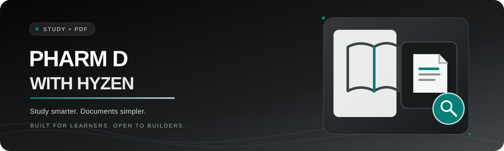
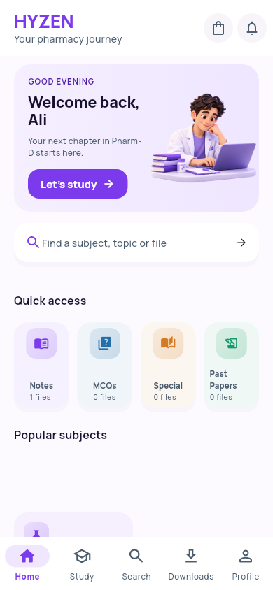
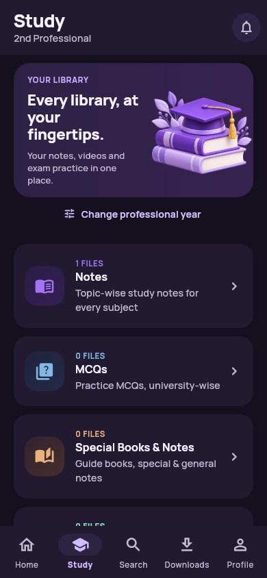
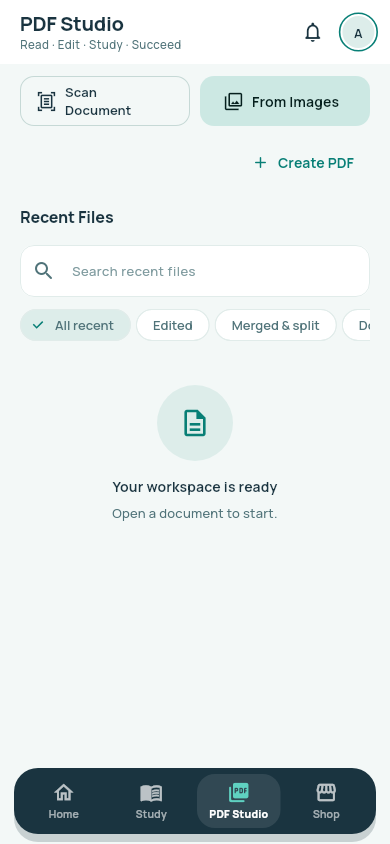
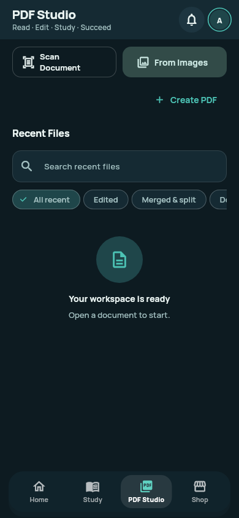
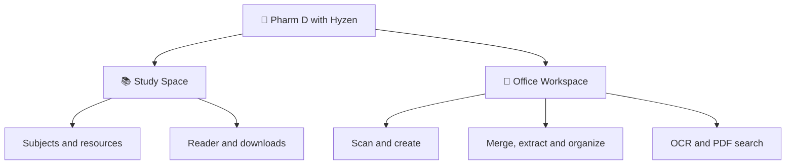

<p align="center">
  
</p>

<div align="center">

**A calmer way to study. A smarter way to work with documents.**

A Flutter-powered study companion for Pharm D students, with a practical **Office Workspace** for scanning, organizing, searching, and creating PDFs.

[](https://flutter.dev/)
[](https://dart.dev/)
[](hyzen_flutter/)
[](LICENSE)

[**Explore Office Workspace**](#-office-workspace--your-pdf-toolkit) · [**Explore Study**](#-a-study-space-built-for-students) · [**Screenshots**](#-a-peek-inside) · [**Get started**](#-get-started) · [**Contribute**](CONTRIBUTING.md)

</div>

---

<table>
<tr>
<td width="67%" valign="middle">

### 👋 Meet Hyzen

**Big study plans. Less document chaos.**

Keep your subject resources close, your PDFs organized, and your study flow moving — without juggling a collection of disconnected tools.

Designed with students in mind. Useful for anyone working with PDFs.

</td>
<td width="33%" align="center">

</td>
</tr>
</table>

## ✨ Two workspaces. One companion.

<table>
<tr>
<td width="50%" valign="top">
<h3>📚 Study Space</h3>
<p>Browse subject resources, pick up where you left off, and keep useful learning materials accessible — including offline downloads.</p>
<p><strong>For:</strong> Pharm D students, coursework, and daily revision.</p>
</td>
<td width="50%" valign="top">
<h3>📄 Office Workspace</h3>
<p>Create and scan PDFs, merge and split files, reorganize pages, annotate documents, and search recognized text.</p>
<p><strong>For:</strong> class notes, handouts, forms, and everyday documents.</p>
</td>
</tr>
</table>

## 📄 Office Workspace — your PDF toolkit

The Office Workspace is a major focus of this repository. Its Flutter and Android implementation is being developed around practical student document workflows.

| Tool | What it helps with |
|:--|:--|
| 📷 **Scan & create** | Turn camera scans or gallery images into PDFs, with page review and crop tools |
| 🧩 **Merge, split & extract** | Combine documents, separate ranges, or select individual pages |
| 🔄 **Organize pages** | Rotate, reorder, remove, or add pages while retaining separate working copies |
| ✍️ **Annotate** | Add supported highlights, drawings, shapes, and text annotations |
| 🔎 **OCR & PDF search** | Recognize Latin-script text on-device and search document content |
| 🔒 **Protected copies** | Use password-protected PDF exports where supported |
| 📤 **Export & share** | Save, share, or export supported document formats |

> [!NOTE]
> Implementation and validation vary by feature. OCR is Latin-script focused; some cloud integrations, real-device scanner checks, and release acceptance tests remain in progress. PDF-to-DOCX conversion does not promise pixel-perfect layouts. See the [PDF feature notes](hyzen_flutter/docs/PDF_STUDIO_1_4_1.md) and [current development progress](REDESIGN_PROGRESS.md).

## 📚 A study space built for students

- **Subject-first navigation** — get to learning resources without extra clutter.
- **Continue studying** — return to recently accessed materials.
- **Downloads** — keep supported resources available for offline access.
- **Search & discover** — find relevant study content more easily.
- **Focused UI** — light and dark layouts with accessibility and small-screen improvements.

Educational content availability may depend on account access, backend setup, and source permissions.

## 📱 A peek inside

<p align="center"><i>Selected development screenshots from the repository — designs are evolving.</i></p>

<table>
<tr>
<th align="center">🏠 Home</th>
<th align="center">📚 Study</th>
</tr>
<tr>
<td align="center"></td>
<td align="center"></td>
</tr>
<tr>
<th align="center">📄 PDF Workspace</th>
<th align="center">🌙 Dark Workspace</th>
</tr>
<tr>
<td align="center"></td>
<td align="center"></td>
</tr>
</table>

## 🧭 How the project fits together



## 🛠️ Built with

| Layer | Technology |
|:--|:--|
| App | Flutter & Dart |
| Mobile platform | Android |
| PDF workflows | Flutter + native Android document processing |
| OCR | On-device ML Kit Latin recognition |
| Optional services | Firebase and configured Google integrations |
| CI & review | GitHub Actions, Flutter analysis, tests, and preview workflows |

The maintained Flutter source lives in [`hyzen_flutter/`](hyzen_flutter/). The repository also includes release support files, historical source artifacts, documentation, and workflow tooling.

## 🚀 Get started

**Requirements:** Flutter 3.35.4, Dart 3.9.x, JDK 17, Android SDK.

```bash
git clone https://github.com/Horizon003/pharm-d-with-hyzen.git
cd pharm-d-with-hyzen/hyzen_flutter

flutter pub get
flutter analyze
flutter test
flutter run
```

Some signed-in features require an authorized backend configuration, and production APK signing needs the owner's private credentials. Never commit credentials or keystores. Read the [Flutter source README](hyzen_flutter/README.md) for additional setup and feature limitations.

## 🚧 Development status

**Actively maintained / evolving.** Not every feature has completed physical Android acceptance testing. Live Drive API/OAuth configuration and some production validation remain outstanding; no claim is made that all workflows are production-ready.

[](https://github.com/Horizon003/pharm-d-with-hyzen/actions/workflows/android-apk.yml)

- **Repository established:** October 16, 2026.
- **Commit history:** [View development activity](https://github.com/Horizon003/pharm-d-with-hyzen/commits/main/).
- **Issue tracking:** [Open issues and improvement ideas](https://github.com/Horizon003/pharm-d-with-hyzen/issues).
- **Historical release details:** [Archived 1.3.3 README](docs/RELEASE_1_3_3_ARCHIVE.md).

This project has used AI-assisted engineering workflows, including ChatGPT, alongside maintainer-led requirements, coding, reviews, debugging, and automated tests.

## 🤝 Contribute

Students, developers, testers, and accessibility-minded contributors are welcome.

1. Look through [Issues](https://github.com/Horizon003/pharm-d-with-hyzen/issues).
2. Read [CONTRIBUTING.md](CONTRIBUTING.md).
3. Make a focused change, run analysis/tests, and open a pull request.

Found a vulnerability? Please follow [SECURITY.md](SECURITY.md) rather than posting secrets in public issues.

## ⚖️ License and artwork

Original project code is made available under the [MIT License](LICENSE). **The Hyzen name, logo, panda mascot, illustrations, brand imagery, reference UI artwork, and third-party materials are not automatically licensed under MIT.** See [ASSET_POLICY.md](ASSET_POLICY.md) for the asset and third-party distinction.

---

<p align="center">

<br/>
<strong>Made for study sessions, built to keep improving.</strong>
<br/>
<sub>Pharm D with Hyzen · Maintained by Horizon003 and contributors</sub>
</p>
